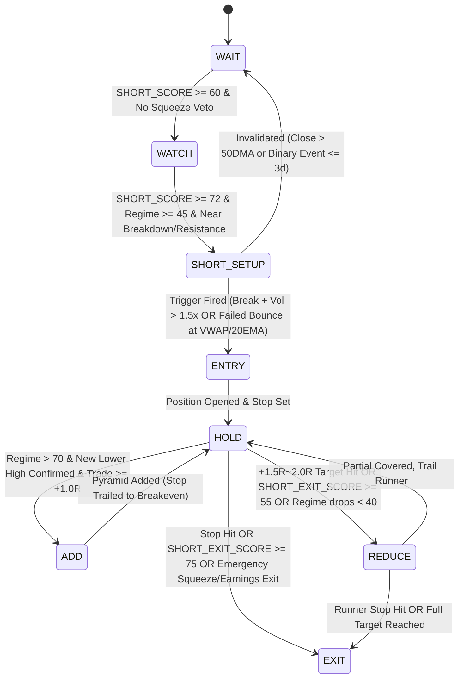

# 美股量化空方交易監控與決策系統 (US Equity Short-Biased Quant Dashboard) — 系統架構與量化規則規格書

> **系統定位**：機構級美股空方量化監控、因子評分、進退場狀態機與組合風控引擎  
> **核心決策流**：`MARKET REGIME → SECTOR → STOCK → TECHNICAL SETUP → CATALYST → TRIGGER → SIZE → STOP → TARGET → EXIT`  
> **資料誠信原則 (Data Integrity Rule)**：任何指標或欄位若缺乏可靠來源（例如未接 Ortex/IBKR 時的即時借券費率 Borrow Fee Rate 或即時 GEX），系統強制標記為 `DATA UNAVAILABLE` 或 `INSUFFICIENT DATA`，並於信心水準 (`CONFIDENCE`) 中扣除資訊缺口懲罰項，**絕不自行猜測或強行插補訊號**。

---

## 一、 系統核心原則與底層邏輯 (Core Principles & Mathematical Philosophy)

### 1.1 機率化表達與禁用語規範
做空交易具有**損失理論無限、獲利上限 100%、且受正偏態軋空風險（Right-Tail Squeeze Risk）與借券成本（Carry Cost）侵蝕**的不對稱特性。本系統嚴格禁止任何主觀預測字眼（如「一定會跌」、「必跌」、「保證破底」），所有輸出統一轉化為四個量化維度：

1. **Bearish Probability ($P_{\text{bear}} \in [0\%, 95\%]$)**：基於大盤環境、個股五維度空方因子與歷史同類訊號勝率貝氏更新後的下跌機率估計。
2. **Expected Risk/Reward Ratio ($R/R$)**：
   $$R/R = \frac{\text{Entry Price} - \text{Target Price}_1}{\text{Stop Price} - \text{Entry Price}}$$
   僅當 $R/R \ge 2.0$ 且扣除預估滑價與持倉期間借券成本後仍具正期望值（$\mathbb{E}[R] > 0.35R$）時，才具備交易價值。
3. **Confidence Score ($\text{CONFIDENCE} \in [0\%, 100\%]$)**：
   $$\text{CONFIDENCE} = \text{Data Completeness Ratio} \times \left(0.45 \times \text{Factor Alignment} + 0.30 \times \text{Regime Alignment} + 0.25 \times \text{Historical Grade WinRate}\right)$$
   若關鍵欄位（如財報日、SI%、成交量）為 `DATA UNAVAILABLE`，$\text{Data Completeness Ratio}$ 自動下調，直接壓低信心水準。
4. **訊號分級 (`RATING`)**：
   - **A+ (85–100)**：五維度共振、大盤 Risk-Off、無軋空與二元事件風險、帶量破位確認。
   - **A (72–84)**：核心趨勢與籌碼破位明確，大盤至少 Neutral，軋空風險低。
   - **B (58–71)**：基本面或技術面偏空，但缺乏觸發條件或大盤逆風（僅列入 `WATCH`）。
   - **C (40–57)**：多空訊號分歧或軋空風險偏高（列入 `WAIT`）。
   - **D (< 40)**：強勢多頭或高軋空危險標的（強制 `AVOID`）。
   - **硬性規定**：僅 **A+ 與 A 級** 且通過安全濾網的標的，才可進入 `ACTIONABLE SHORT LIST`。

### 1.2 核心區分：「基本面/結構看空 (Fundamentally Bearish)」vs.「現在適合做空 (Actionable Short / Safe to Short)」

在實戰中，高估值、虧損或商業模式惡化的公司可能在流動性氾濫或軋空行情中暴漲 100% 以上。系統在架構上將兩者拆分為正交的兩個軸線：

| 維度 | Fundamentally / Structurally Bearish (看空評分高) | Actionable Short / Safe to Short (現在可執行做空) |
| :--- | :--- | :--- |
| **核心問題** | 這家公司或股票中期是否脆弱、高估或處於派發階段？ | **今天、此刻**進場做空是否具備正期望值與可控尾部風險？ |
| **決定因子** | 基本面惡化 (Factor D)、中長期均線走平/下彎、籌碼派發 (Factor C) | 大盤 Regime $\ge 45$、無迫近財報 ($>3$ 天)、低軋空風險 (`Squeeze Score < 60`)、價格跌破關鍵結構且出現 **Failed Bounce Trigger** |
| **系統狀態** | 可能處於 `WATCH` 或 `WAIT`（若股價仍在 20EMA 之上或借券費率飆升） | 必須處於 `SHORT SETUP` 或 `ENTRY` 狀態，且 `Actionable Gate == True` |

**Actionable Short 硬性安全閘門 (Safety Gate Formula)**：
$$\text{IsActionable} = (\text{SHORT\_SCORE} \ge 72) \land (\text{MARKET\_REGIME\_SCORE} \ge 45) \land (\text{SQUEEZE\_RISK\_SCORE} < 60) \land (\text{DaysToEarnings} > 3) \land (\text{TriggerFired} = \text{True})$$

---

## 二、 模組 1：大盤總體環境監控（Macro & Market Regime Filter）

建立做空的總體環境濾網，避免在指數多頭強勢噴出（廣度擴張、VIX 低位收斂）時逆勢摸頂。

### 2.1 Market Regime Score (`MARKET_REGIME_SCORE`, 0–100 分)
同時監控三大基準指數 **SPY (大型股)、QQQ (科技成長)、IWM (小型股/高 Beta 空頭主戰場)**。對每個指數 $i \in \{\text{SPY}, \text{QQQ}, \text{IWM}\}$（權重分別為 $0.40, 0.35, 0.25$）計算：

1. **均線破位與斜率子分數 ($S_{\text{MA}, i}$, 0–40 分)**：
   - 收盤價 $< \text{EMA}_{20}$：$+12$ 分；且 $\text{Slope}(\text{EMA}_{20}, 5\text{d}) < 0$：$+5$ 分
   - 收盤價 $< \text{SMA}_{50}$：$+12$ 分；且 $\text{Slope}(\text{SMA}_{50}, 10\text{d}) < 0$：$+5$ 分
   - 收盤價 $< \text{SMA}_{200}$：$+6$ 分（完全空頭排列 $\text{Close} < \text{EMA}_{20} < \text{SMA}_{50} < \text{SMA}_{200}$）
2. **指數派發日與量價分布子分數 ($S_{\text{Dist}, i}$, 0–25 分)**：
   - 定義 **Distribution Day (派發日)**：指數當日跌幅 $\le -0.20\%$ 且當日成交量 $V_t > V_{t-1}$ 且 $V_t > \text{SMA}(V, 20)$。
   - 過去 25 個交易日內累積派發日數量 $N_{\text{dist}}$：
     $$S_{\text{Dist}, i} = \min\left(25, \; 5 \times N_{\text{dist}}\right)$$
3. **跨指數同步轉弱與市場寬度/波動共振 ($S_{\text{Macro}}$, 0–35 分)**：
   - $0.50 \times \text{BREADTH\_WEAKNESS\_SCORE} \times 0.35 + 0.50 \times \text{VOLATILITY\_REGIME\_SCORE} \times 0.35$

**總分區間與部位管理硬性規則**：

| Market Regime Score | 狀態定義 | 空方總曝險上限 (Max Gross Short) | 部位管理與開關規則 (Execution Policy) |
| :--- | :--- | :--- | :--- |
| **0 – 40 分** | **Risk-On** (多頭強勢 / 軋空高發期) | **$\le 15\%$** (僅限對沖部位) | **禁止開立新投機空單 (`NEW ENTRY BLOCKED`)**。若分數跌破 30 分，現有空單強制減倉 50% (`MANDATORY REDUCE`)，且將停損收緊至 $1.0\times \text{ATR}$。 |
| **41 – 60 分** | **Neutral / Transition** (震盪分化 / 觀察期) | **$\le 45\%$** | 僅開放 **A+ 級** 個股且具備明確相對弱勢（RS 破底）之 Setup，單筆風險減半（$0.5\times$ 標準部位）。 |
| **61 – 100 分** | **Risk-Off** (空方主場 / 順勢破位期) | **$\le 100\%$** (依風控上限) | **全面開放 A+ 與 A 級空方部位 (`SHORT BOOK OPEN`)**。當分數 $> 75$ 且確認 Lower High 時允許順勢加碼 (`ADD` 開放)。 |

### 2.2 市場寬度惡化評分 (`BREADTH_WEAKNESS_SCORE`, 0–100 分)
衡量指數表面之下的結構性腐蝕（特別是「少數權值股撐盤、多數個股破底」的熊市前兆）：
$$\text{BREADTH\_WEAKNESS\_SCORE} = 0.30 B_{50\text{MA}} + 0.25 B_{200\text{MA}} + 0.25 B_{\text{NHNL}} + 0.20 B_{\text{AD}}$$
- **$B_{50\text{MA}}$ (高於 50MA 比例惡化)**：設 $p_{50}$ 為成分股高於 50SMA 的百分比，$B_{50\text{MA}} = \text{clip}(100 - p_{50}, 0, 100)$。若 SPY 在 50SMA 之上但 $p_{50} < 45\%$，額外加上 $+10$ 分「寬度背離懲罰 (Breadth Divergence Boost)」。
- **$B_{200\text{MA}}$ (高於 200MA 比例惡化)**：$B_{200\text{MA}} = \text{clip}(100 - p_{200}, 0, 100)$。
- **$B_{\text{NHNL}}$ (52 週新高減新低家數差 Net New Highs/Lows)**：
  $$\text{NHNL Ratio} = \frac{\text{New Lows}_{52\text{W}} - \text{New Highs}_{52\text{W}}}{\text{Total Issues}}$$
  當新低家數大於新高家數時線性映射至 $50–100$ 分；反之映射至 $0–49$ 分。
- **$B_{\text{AD}}$ (Advance/Decline 騰落線斜率)**：過去 10 日累積 $\sum (\text{Adv} - \text{Dec})$ 斜率轉負且跌破其 20EMA 時給 $75–100$ 分。

### 2.3 波動度與避險情緒 (`VOLATILITY_REGIME_SCORE`, 0–100 分)
- **VIX 絕對位階與變化率 (35%)**：
  - VIX $> 20$ 且 5 日變化率 $\text{RoC}_{5\text{d}}(\text{VIX}) > +15\%$ 時，代表避險情緒急遽升溫（高分）；
  - **極端恐慌防追空保護**：若 VIX $> 38$ 且單日衝高回落留長上影線，標記 `VOLATILITY CLIMAX WARNING`（防範空頭暴力回補反彈，暫停追空新倉，僅等反抽）。
- **VIX 期限結構 (`VIX Term Structure`, $\text{Ratio}_{\text{TS}} = \text{VIX} / \text{VIX3M}$ 或 $\text{VIX}/\text{VXV}$) (40%)**：
  - $\text{Ratio}_{\text{TS}} < 0.88$：Contango (正價差，市場安逸，得分 $<25$)
  - $0.88 \le \text{Ratio}_{\text{TS}} < 1.00$：趨平 (Flattening，得分 $30–65$)
  - **$\text{Ratio}_{\text{TS}} \ge 1.00$：Backwardation (期限結構倒掛)** $\rightarrow$ 機構恐慌買入近月保護，直接給予 $80–100$ 分，並觸發空方權重提升訊號 (`TERM STRUCTURE INVERSION BOOST`)。
- **Put/Call Ratio (25%)**：監控總量與股票型 Put/Call Ratio (`P/C Ratio`) 5MA：當 5MA $> 0.95$ 且持續上升時確認空方避險動能。

---

## 三、 模組 2：個股空方候選池量化因子（Stock Screener & Scoring）

每檔 Watchlist 標的計算綜合空方評分 `SHORT_SCORE` $\in [0, 100]$：
$$\text{SHORT\_SCORE} = 0.25 F_{\text{Trend}} + 0.15 F_{\text{RS}} + 0.15 F_{\text{Vol}} + 0.25 F_{\text{Fund}} + 0.20 F_{\text{Deriv}}$$

### A. 價格趨勢與形態破位 (`Price Trend & Breakdown`, 權重 25%) — $F_{\text{Trend}} \in [0, 100]$
1. **均線距離與斜率 (45 分)**：
   - 計算價格相對 `20DMA`, `50DMA`, `200DMA` 的標準化距離 $z_m = \frac{P - \text{SMA}_m}{\text{ATR}_{14}}$ 與均線 10 日斜率。
   - 跌破 `20DMA` 且斜率 $<0$ ($+12$)；跌破 `50DMA` 且斜率 $<0$ ($+15$)；跌破 `200DMA` 或 `20DMA < 50DMA` 死亡交叉 ($+10$)；
   - **過度乖離扣分 (Overextension Penalty)**：若 $z_{20} < -3.0$（股價已遠離 20DMA 超過 3 倍 ATR），扣除 $15$ 分以防止在短線超跌處追空。
2. **結構破位形態識別 (55 分)**：
   - **跌破關鍵水平支撐 (Support Breakdown)**：收盤跌破過去 20–60 日樞紐低點（Pivot Low / 頸線 Neckline）且幅度 $> 0.3 \times \text{ATR}_{14}$ ($+25$ 分)。
   - **頭部形態 (Double Top / Head & Shoulders)**：過去 60 日內出現兩個以上高點，右肩/第二高點未能站穩前高（或出現 Lower High $H_2 \le 1.01 H_1$）並跌破中間回檔低點頸線 ($+20$ 分)。
   - **假突破誘多破位 (Failed Breakout / Bull Trap)**：近 10 日內曾突破前高但 3 日內迅速跌回前高之下且收於當日最低 25% 分位 ($+10$ 分)。

### B. 相對強弱與動能 (`Relative Weakness & Momentum`, 權重 15%) — $F_{\text{RS}} \in [0, 100]$
1. **對比大盤與板塊相對弱勢 (45 分)**：
   - 計算個股對比 SPY、QQQ 及所屬 GICS 板塊 ETF（如 SMH/XLK/XLY/XLF）的 20 日與 60 日超額報酬 $\alpha_{20}, \alpha_{60}$。
   - **領先破底 (New Low Ahead of Market)**：當 SPY 距離 20 日低點仍 $> 2\%$，但個股已創 20 日或 60 日新低 ($+20$ 分)。
2. **下行 Beta 不對稱性 (`Beta Downside Asymmetry`) (25 分)**：
   - 分別計算過去 60 日大盤下跌日的下行 Beta ($\beta^-$) 與大盤上漲日的上行 Beta ($\beta^+$)：
     $$\text{Asymmetry Ratio} = \frac{\beta^-}{\max(0.2, \beta^+)}$$
   - 若 $\beta^- > 1.2$ 且 $\text{Asymmetry Ratio} > 1.3$（大盤漲時不跟漲、大盤跌時跌更重），給滿 25 分。
3. **動能轉弱與背離 (30 分)**：
   - **RSI 熊市背離或弱勢區間**：$\text{RSI}_{14} \in [35, 52]$ 且從中軸 50 受阻向下（最佳做空動能帶，給 15 分；若 $\text{RSI}_{14} < 28$ 則標記超賣不給動能分）。若價格創波段新高而 $\text{RSI}_{14}$ 未創新高則觸發 `RSI Bearish Divergence` ($+15$ 分)。
   - **MACD 動能**：MACD 柱狀體 (Histogram) 轉負且快線跌破零軸或於零軸下死叉 ($+15$ 分)。

### C. 成交量與籌碼派發 (`Volume & Institutional Distribution`, 權重 15%) — $F_{\text{Vol}} \in [0, 100]$
1. **下跌放量 vs. 反彈縮量比率 (`Up/Down Volume Asymmetry`) (40 分)**：
   - 計算過去 20 日下跌日平均成交量 $\bar{V}_{\text{down}}$ 與上漲日平均成交量 $\bar{V}_{\text{up}}$ 之比值：
     $$R_{\text{UDV}} = \frac{\bar{V}_{\text{down}}}{\bar{V}_{\text{up}}}$$
   - 當 $R_{\text{UDV}} > 1.25$ 且近期反彈日成交量 $< 0.85 \times \text{SMA}(V, 20)$（反彈無量確認買盤枯竭）時給予高分。
2. **機構派發日累積 (`Distribution Days`) (35 分)**：
   - 過去 25 個交易日內，個股跌幅 $> 1.0\%$ 且成交量 $> \text{SMA}(V, 20)$ 的天數 $D_{25}$。$D_{25} \ge 5$ 為重度機構派發。
3. **量價資金流背離 (OBV / CMF) (25 分)**：
   - 20 日 Chaikin Money Flow ($\text{CMF}_{20}$) $< -0.10$ 且 OBV 20 日斜率為負。

### D. 基本面與催化劑風險 (`Fundamental & Catalyst Risk`, 權重 25%) — $F_{\text{Fund}} \in [0, 100]$
同時輸出基本面脆弱度評分與獨立的 **`CATALYST_RISK_SCORE` (0–100)**：
1. **基本面惡化與估值泡沫 (60 分)**：
   - **營收動能放緩**：YoY 或 QoQ 營收成長率減速或轉負 ($0–15$ 分)
   - **利潤率壓縮**：營業利益率 (Operating Margin) 或毛利率較過去四季均值下滑或為負 ($0–15$ 分)
   - **現金流與財務槓桿**：自由現金流 (FCF) 為負、高負債比 ($\text{Debt/Equity} > 150\%$) 或現金消耗率高 ($0–15$ 分)
   - **高估值脆弱度**：$\text{EV/Sales} > 12\times$ 或 $\text{Forward P/E} > 45\times$ 且成長率無法支撐 ($0–15$ 分)
2. **催化劑與事件評分 (`CATALYST_RISK_SCORE`) (40 分)**：
   - **空方正面催化劑 (Bearish Catalysts)**：近期宣布 ATM 增發 / 可轉債稀釋、內部人集群拋售 (Form 4 Insider Selling)、分析師下修評級與財測指引下調。
   - **二元事件紅色警告 (Binary Event Red Flag)**：
     - **若距離財報日 $\le 3$ 個交易日**：強制發出 **`RED WARNING: EARNINGS WITHIN 3 DAYS`**，將個股狀態鎖定為 `WAIT` 或 `REDUCE/EXIT`，禁止新開空單（防範財報跳空軋空）。

### E. 軋空與衍生品風險 (`Short Squeeze & Options Risk`, 權重 20%) — $F_{\text{Deriv}} \in [0, 100]$
此模組包含兩個子系統：**衍生品空方訊號 ($F_{\text{Deriv}}$)** 與獨立一票否決指標 **`SQUEEZE_RISK_SCORE` (0–100)**。

1. **獨立軋空風險指數 (`SQUEEZE_RISK_SCORE`, 0–100 分)**：
   $$\text{SQUEEZE\_RISK\_SCORE} = 0.35 S_{\text{SI\%}} + 0.25 S_{\text{DTC}} + 0.25 S_{\text{Borrow}} + 0.15 S_{\text{PriceThrust}}$$
   - **Short Interest % of Float ($S_{\text{SI\%}}$)**：$<10\%$ 低風險 ($10$ 分)；$10–20\%$ 中度 ($45$ 分)；$>20\%$ 高度警戒 ($80$ 分)；$>30\%$ 極度危險 ($100$ 分)。
   - **Days to Cover ($S_{\text{DTC}}$)**：$> 5$ 天給 $60+$ 分；$> 8$ 天給 $90+$ 分。
   - **Borrow Fee Rate 借券費率 ($S_{\text{Borrow}}$)**：$< 1.5\%$ 正常 (GC, General Collateral)；$3\%–10\%$ 升溫；$> 15\%$ 或單週暴增 $> 2\times$ 為 Hard-to-Borrow 極端軋空前兆 ($90–100$ 分)。*(註：若未連接 IBKR/Ortex，系統必須標記 `Borrow Fee: DATA UNAVAILABLE`，絕不偽造數值)*。
   - **複合軋空警報 (`SQUEEZE WARNING`)**：若 $\text{SI\%} > 18\%$ + 價格突破 20DMA（或單日帶量暴漲 $> 6\%$）+ 借券費率異常，立即觸發 `HIGH SQUEEZE RISK`，在總分中扣減並強制阻斷進場。
2. **衍生品空方訊號 ($F_{\text{Deriv}}$ 正向貢獻)**：
   - 期權 Put/Call Open Interest 與 Volume 偏態、價外賣權異常買入 (OTM Put Sweep)、買權異常賣出壓頂 (Call Wall / Unusual Call Selling)、以及處於負 Gamma 區間（Dealer Short Gamma 助跌環境）且無軋空風險時給予高分。

---

## 四、 模組 3：精確進退場規則引擎（Execution Signals & Triggers）

系統採用 **8 狀態有限狀態機 (8-State Execution FSM)**，嚴格禁止模糊的「買/賣」建議：



### 4.1 八大狀態定義 (8 Execution States)
1. **`WAIT`**：環境不合適（Regime $< 40$）、財報 $\le 3$ 天、軋空風險過高（`Squeeze Score >= 60`）或空方分數不足（$< 60$）。
2. **`WATCH`**：基本面與中期結構偏空（`SHORT_SCORE` $60–71$），但價格尚未到達關鍵破位點或反抽壓力位。
3. **`SHORT SETUP`**：`SHORT_SCORE` $\ge 72$，大盤允許，股價正處於關鍵頸線邊緣或反抽測試 `20EMA / VWAP` 壓力帶，等待價格行為觸發。
4. **`ENTRY`**：當日或盤中已滿足具體 **Entry Trigger**，且風險報酬比 $R/R \ge 2.0$，建議執行初始部位建立。
5. **`ADD`**：既有空單浮盈 $\ge +1.0R$，大盤 Regime $> 70$，股價反彈無量確認新的 **Lower High** 並再次跌破短線支撐，允許金字塔式加碼（最多加碼 1 次，為初始部位的 $50\%$）。
6. **`HOLD`**：空單在手，價格維持在 `20DMA` 與移動停損價之下，空方趨勢完好。
7. **`REDUCE`**：觸及第一目標價 `TARGET 1`（$+1.5R \sim +2.0R$）、或 `SHORT_EXIT_SCORE` 介於 $55–74$ 分（出現短線超賣 $\text{RSI} < 28$ 或大盤退回 Neutral），建議回補 $50\%$ 鎖定獲利並將剩餘部位停損下移至成本價。
8. **`EXIT`**：觸發停損價 `STOP`、`SHORT_EXIT_SCORE` $\ge 75$、重新收盤站上 `20DMA/50DMA`、或觸發軋空/財報緊急平倉 (`EMERGENCY EXIT`)。

### 4.2 進場觸發器 (Entry Triggers)
區分「看空」與「觸發做空」，進場必須滿足以下三種量化 Trigger 之一：
- **Trigger Type 1 — 關鍵支撐帶量跌破 (`Breakdown with Volume Expansion`)**：
  $$\text{Close}_t < \text{SupportLevel}_{20\text{d}} \;\land\; V_t \ge 1.35 \times \text{SMA}(V, 20) \;\land\; \text{ClosePositionInRange}_t \le 0.30$$
- **Trigger Type 2 — 弱勢反抽受阻 (`Failed Bounce / Rejection at 20EMA or VWAP`)**：
  股價處於 `50DMA` 之下，反彈觸及 `20EMA`（或區間锚定 VWAP）附近 $\pm 0.5\times \text{ATR}_{14}$，反彈過程成交量萎縮（$< 0.9\times \text{SMA}(V, 20)$），隨即出現帶上影線黑 K 或吞噬黑 K 且跌破前一日低點（確認 Lower High）。
- **Trigger Type 3 — 假突破誘多反轉 (`Failed Breakout Reversal`)**：
  盤中或前日突破區間高點後，當日帶量（$>1.5\times$ 均量）跌回支撐區間內並收在最低點附近。

### 4.3 動態波動度停損與部位規模計算 (`Stop-Loss & Position Sizing Model`)
- **嚴禁固定百分比停損**。停損價格 $\text{STOP}$ 取「結構反壓點」與「ATR 波動度緩衝」之較高保護位（並受限於最大合理波動上限）：
  $$\text{STOP} = \max\left(\text{Recent Swing High}_{5\text{d}} + 0.25 \times \text{ATR}_{14}, \;\; \text{EntryPrice} + 1.75 \times \text{ATR}_{14}\right)$$
  同時設定**收盤失效條件 (`INVALIDATION`)**：若日線收盤價站上 $\max(\text{STOP}, \text{SMA}_{20} + 0.5\times \text{ATR}_{14})$，無條件失效離場。
- **部位規模公式 (Position Sizing Engine)**：
  給定帳戶總資金 $\text{AccountSize}$、基礎單筆風險比例 $r_{\text{base}}$（預設 $0.75\%$）、大盤環境乘數 $M_{\text{regime}} \in \{0.0, 0.5, 1.0\}$、軋空風險折減係數 $M_{\text{squeeze}} \in [0.4, 1.0]$ 與相關性懲罰係數 $M_{\text{corr}} \in [0.5, 1.0]$：
  $$\text{MaxRiskDollar} = \text{AccountSize} \times r_{\text{base}} \times M_{\text{regime}} \times M_{\text{squeeze}} \times M_{\text{corr}}$$
  $$\text{RiskPerShare} = \text{STOP} - \text{EntryPrice}$$
  $$\text{PositionShares} = \left\lfloor \frac{\text{MaxRiskDollar}}{\text{RiskPerShare}} \right\rfloor, \quad \text{且受限於單一部位市值上限 } \le 12\% \times \text{AccountSize}$$

### 4.4 停利與回補評分引擎 (`SHORT_EXIT_SCORE`, 0–100 分)
- **目標價設定**：
  - `TARGET 1`（減倉 50% 點位）：$\min(\text{Nearest Structural Support}, \; \text{EntryPrice} - 2.0 \times \text{RiskPerShare})$
  - `TARGET 2`（波段主目標）：$\min(\text{Major Demand Zone / 200DMA}, \; \text{EntryPrice} - 3.5 \times \text{RiskPerShare})$
- **`SHORT_EXIT_SCORE` 組成**：
  1. **R-Multiple 達標度 (0–25 分)**：浮盈達 $+1.5R$ ($+12$ 分)，達 $+3.0R$ ($+25$ 分)。
  2. **超賣動能收斂 (0–25 分)**：$\text{RSI}_{14} < 28$ 且出現底背離或單日留長下影線爆量（Volume Climax $> 2.5\times$ 均量，代表空頭恐慌回補盤湧現）。
  3. **均線重新站回 (0–25 分)**：日線收盤重新站上 `20DMA` ($+15$ 分) 或 `50DMA` ($+25$ 分)。
  4. **緊急出場觸發 (`EMERGENCY EXIT`, 直接拉滿 100 分)**：
     - 觸及 `STOP` 停損價；
     - 借券費率單日暴增 $>2\times$ 或突破 $20\%$ 且股價逆勢抗跌；
     - 距離財報發布進入 $\le 2$ 個交易日且無足夠獲利緩衝（$< 2.5R$）。

---

## 五、 模組 4：風險管理與歷史回測（Portfolio Risk & Backtesting）

### 5.1 投資組合級別風險與相關性風險 (`CORRELATED_SHORT_RISK`)
做空組合最大的致命傷是**表面分散、實質高度共線性**（例如同時做空 NVDA, AMD, AVGO, MU, ARM 五檔半導體股，當 SOX 指數反彈 5% 時五檔同時觸發停損）。

1. **總空頭曝險 (`Total Short Exposure`) 與 Beta 調整後淨曝險 (`Beta-Adjusted Net Exposure`)**：
   $$\text{GrossShortExposure} = \frac{\sum_k |\text{Notional}_k|}{\text{AccountSize}}, \quad \text{BetaWeightedShort} = \sum_k w_k \cdot \beta_k$$
2. **相關性空頭風險 (`CORRELATED_SHORT_RISK` Score, 0–100)**：
   - 計算候選池或持倉組合過去 60 個交易日日報酬率之皮爾森相關係數矩陣 $\mathbf{\Sigma} = [\rho_{ij}]$。
   - **有效獨立部位數 (Effective Number of Independent Bets, $N_{\text{eff}}$)**：
     $$N_{\text{eff}} = \frac{N^2}{\sum_{i=1}^N \sum_{j=1}^N \max(0, \rho_{ij})}$$
     例如若同時做空 5 檔平均相關係數為 $0.80$ 的同板塊股票，雖然名目上 $N=5$，但實際上 $N_{\text{eff}} \approx 1.39$（等同將近 4 倍單筆風險押在同一因子上！）。
   - **板塊與相關性硬性上限**：
     - 單一 GICS 行業板塊空頭曝險不得超過總資金之 **$25\%$**；
     - 若新候選標的與既有持倉之平均相關係數 $\bar{\rho} > 0.70$，自動觸發 `HIGH CORRELATION CLUSTER WARNING`，並將該筆新單之相關性乘數下調為 $M_{\text{corr}} = \sqrt{1 - \bar{\rho}^2}$。

### 5.2 無偏誤回測框架 (`Bias-Free Backtesting Engine`)
1. **防範前視偏誤 (No Look-Ahead Bias)**：
   - 第 $t$ 日收盤產生的 `SHORT_SCORE` 與 `Trigger` 訊號，一律以第 $t$ 日收盤前已確認之滾動視窗資料計算；進場價格嚴格採用第 $t+1$ 日開盤價加計滑價（或觸價單成交價），絕不使用第 $t$ 日最高/最低價事後挑選最佳點位。
   - 基本面資料加計財報發布延遲（Point-in-Time Lag），避免使用未公布之財報數據。
2. **防範倖存者偏誤 (Survivorship Bias Mitigation)**：
   - 歷史清單須保留已下市、被收購（M&A 溢價收購對空方為重大尾部風險！）或破產標的；若僅使用當前成分股進行歷史回測，系統會在回測報告中明確標註 `Universe Warning: Current Watchlist Snapshot`。
3. **空方專屬交易成本模型**：
   - 扣除雙邊滑價與手續費（預設 $10\text{ bps}$）+ 持倉期間日化借券成本（$\text{BorrowFee}_{\text{annual}} / 252 \times \text{HoldingDays}$）。
4. **回測績效指標與分級驗證**：
   - 統計各訊號等級（`A+`, `A`, `B`, `C`, `D`）之 **Win Rate (勝率)**、**Average R-Multiple (平均風報比期望值)**、**Profit Factor (獲利因子)**、**Sharpe Ratio** 與 **Max Drawdown (最大回撤)**。

---

## 六、 模組 5：Dashboard 視覺化、日報、Alert 與標準化個股決策輸出

### 6.1 即時 Alert 觸發規格 (Webhook / Alert Priority Rules)

| 優先級 (Priority) | 觸發條件 (Trigger Condition) | 動作建議 (Action Payload) |
| :--- | :--- | :--- |
| **`CRITICAL`** | 持倉空單 `SQUEEZE_RISK_SCORE >= 75` 或單日借券費率暴增、或價格觸及 `STOP`、或距離財報 $\le 3$ 天 | 立即發送強制平倉 / 避險警報 (`EMERGENCY EXIT / EARNINGS FREEZE`) |
| **`HIGH`** | `MARKET_REGIME_SCORE >= 61` 且 `RATING` 為 `A+/A` 之個股觸發 `ENTRY`（跌破頸線帶量 $>1.5\times$ 或 20EMA/VWAP Failed Rally 確認） | 發送可執行做空進場訊號（附精確 Entry/Stop/Size/Target） |
| **`MEDIUM`** | `SHORT_SCORE >= 72` 進入 `SHORT SETUP` 觀察區，或持倉空單觸及 `TARGET 1` ($+2.0R$) 建議 `REDUCE` | 提醒交易員設置條件單或執行部分停利回補 |
| **`LOW`** | 大盤環境跨區間切換（如 Neutral $\rightarrow$ Risk-Off）或板塊輪動轉弱 | 更新每日觀察名單與部位上限權重 |

### 6.2 個股決策標準化輸出模板 (Mandatory Decision Output Template)
系統不論透過 CLI、API 或 Web Dashboard 輸出單一個股分析時，強制產出以下標準格式：

```text
⸻
TICKER: [股票代碼]
SHORT SCORE: [0-100] / RATING: [A+/A/B/C/D]
MARKET REGIME: [環境狀態]
SECTOR: [板塊狀態]
TREND: [趨勢狀態]
MOMENTUM: [動能狀態]
RELATIVE STRENGTH: [相對強弱狀態]
VOLUME: [籌碼狀態]
FUNDAMENTAL & CATALYST: [基本面與事件風險]
SHORT SQUEEZE RISK: [軋空風險評估]

ENTRY ZONE: [進場區間]
TRIGGER: [具體觸發條件，如 Break below $X with >1.5x volume / Rejection at VWAP]
STOP: [基於 ATR 或關鍵壓力的具體停損價]
TARGET 1: [第一目標價] / TARGET 2: [第二目標價]
RISK / REWARD: [風險報酬比]
CONFIDENCE: [信心水準 %]

ACTION: [目前行動建議，如 WAIT FOR TRIGGER / AVOID]
INVALIDATION: [失效條件，如 Daily close above $X]
⸻
```
