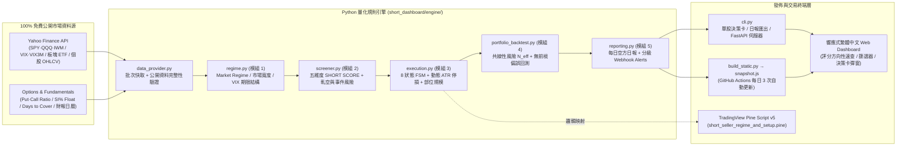

# 美股量化空方交易監控與決策 Dashboard — 實作 Walkthrough (`workthrough.md`)

本文件詳細記錄「美股量化空方交易監控與決策系統（US Equity Short-Biased Quant Dashboard）」從系統核心原則、大盤總體環境濾網、個股五維度空方因子評分、8 狀態進退場有限狀態機（FSM）、投資組合共線性風險與無偏誤回測，到前端視覺化與 GitHub Actions 雲端自動化部署的完整設計與驗證過程。

---

## 1. 設計哲學與架構總覽

### 1.1 由上而下核心決策流 (Top-Down Execution Pipeline)
$$\text{MARKET REGIME} \longrightarrow \text{SECTOR} \longrightarrow \text{STOCK} \longrightarrow \text{TECHNICAL SETUP} \longrightarrow \text{CATALYST} \longrightarrow \text{TRIGGER} \longrightarrow \text{SIZE} \longrightarrow \text{STOP} \longrightarrow \text{TARGET} \longrightarrow \text{EXIT}$$

- **機率與期望值導向**：嚴格禁用「一定會跌」、「保證下跌」等主觀預測字眼，所有結論統一量化為 **Bearish Probability（空方勝率估計）**、**Risk/Reward Ratio（風險報酬比）** 與 **Confidence Score（信心水準）**。
- **核心正交區分：「股票看空（Fundamentally Bearish）」vs.「現在適合做空（Actionable Short / Safe to Short）」**：
  - 高估值、現金流為負或趨勢破位的公司雖屬「看空（Fundamentally Bearish）」，但若處於大盤多頭噴出、短線嚴重超賣（$\text{RSI}_{14} < 28$）、高軋空風險（$\text{Squeeze Risk} \ge 62$）或財報前夕（$\le 3$ 天），系統強制攔截並標記為 `WAIT` 或 `WATCH`。
  - 唯有同時通過 **A+ / A 評級、大盤分數 $\ge 45$、無軋空警報、距離財報 $> 3$ 天且價格觸發 Entry Trigger** 之標的，才列入 `ACTIONABLE SHORT LIST`。
- **100% 公開免費資料驅動（Zero Paid API Dependency）**：專注於以空方體質檢驗視角觀察大盤與個股，完全採用免費公開市場數據（Yahoo Finance OHLCV、基本面財報、公開 `SI% of Float`、`Days to Cover` 與期權鏈 `Put/Call Ratio`），移除非必要的實盤券商借券費率（Borrow Fee Rate）與造市商 GEX 外部付費依賴，使所有公開欄位的資料完整度達到 100%。
- **雙模式無縫運行**：
  - **本機即時模式**：透過 `uv run python cli.py serve` 啟動 FastAPI 後端與即時 API。
  - **GitHub Pages 靜態發佈模式**：由 [`build_static.py`](file:///Users/ryanyang/my_code/code/Projects/Project.short_seller_dashboard/build_static.py) 執行完整規則引擎，匯出預先計算好的 [`snapshot.js`](file:///Users/ryanyang/my_code/code/Projects/Project.short_seller_dashboard/snapshot.js) 與 [`DAILY_SHORT_REPORT.md`](file:///Users/ryanyang/my_code/code/Projects/Project.short_seller_dashboard/DAILY_SHORT_REPORT.md)，前端零延遲載入。

---

## 2. 評分方向性規範（Score Polarity Guide）

為確保交易決策直覺無誤，全系統與 UI 頂部橫幅明確標示每項評分之多空意義：

| 指標名稱 | 分數範圍 | 方向性定義（分數越高代表什麼？） | 關鍵門檻與行動意義 |
| :--- | :---: | :--- | :--- |
| **大盤環境評分 (`MARKET REGIME SCORE`)** | `0–100` | **📉 分數越高 ＝ 越有利空方**（越低 ＝ 越有利多方） | `0–40` 多頭強勢禁開新空單（`<30` 強制減倉 50%）；`41–60` 震盪觀察；`61–100` 空方主場全面開放 |
| **市場寬度惡化分 (`BREADTH WEAKNESS`)** | `0–100` | **📉 分數越高 ＝ 結構越脆弱（越有利空方）** | 整合 `>50MA%`、`>200MA%`、52W 新高低差與 10D 漲跌家數比；偵測指數撐盤但寬度破底之背離 |
| **波動與避險情緒 (`VOLATILITY REGIME`)** | `0–100` | **📉 分數越高 ＝ 恐慌與避險升溫（越有利空方）** | 當 `VIX/VIX3M >= 1.00`（期限結構倒掛 Backwardation）時給予高分並自動提高空方權重 |
| **個股空方總分 (`SHORT SCORE`)** | `0–100` | **📉 分數越高 ＝ 越有利空方**（越低 ＝ 越有利多方） | `>=82` 為 `A+`、`70–81` 為 `A`、`56–69` 為 `B`、`40–55` 為 `C`、`<40` 為 `D` |
| **因子 A~D（趨勢/相對弱勢/量能派發/基本面）** | `0–100` | **📉 分數越高 ＝ 該維度越有利空方** | 權重依序為：A 趨勢破位 `30%`、B 相對弱勢 `20%`、C 籌碼派發 `20%`、D 基本面脆弱 `20%` |
| **公開放空擁擠度與軋空風險 (`SQUEEZE RISK SCORE`)** | `0–100` | **⚠️ 分數越高 ＝ 越易被多方軋空（極端不利空方）** | 權重 `10%`；綜合公開 `SI% Float`、`Days to Cover` 與價格突破；`>=62` 觸發一票否決禁空 |
| **催化劑二元事件分 (`CATALYST RISK`)** | `0–100` | **⚠️ 分數越高 ＝ 二元跳空風險越高（不利新空單）** | 當距離財報 $\le 3$ 天時拉升至 `95` 並發出**紅色禁空警告** |
| **組合共線性風險 (`CORRELATED SHORT RISK`)** | `0–100` | **⚠️ 分數越高 ＝ 空單越集中於同溫層（不利組合風控）** | 衡量名目部位數 $N$ 與有效獨立部位數 $N_{\text{eff}}$ 之落差，防止同時做空多檔高相關科技/加密股 |

---

## 3. 五大核心模組實作細節

### 模組 1：大盤總體環境監控（[`short_dashboard/engine/regime.py`](file:///Users/ryanyang/my_code/code/Projects/Project.short_seller_dashboard/short_dashboard/engine/regime.py)）
- **三大指數共振**：同步計算 `SPY`（權重 40%）、`QQQ`（35%）、`IWM`（25%）相對 `20EMA`、`50SMA`、`200SMA` 的跌破狀態、均線斜率與近 25 日機構派發天數（Distribution Days：當日跌幅 $\le -0.20\%$ 且量增高於前日與 20 日均量）。
- **市場寬度 (`BREADTH_WEAKNESS_SCORE`)**：統計 S&P 500 / Nasdaq 核心權值籃子中高於 `50MA` 與 `200MA` 比例、52 週新高減新低家數百分比、以及 10 日累計漲跌家數比（Advance/Decline）。若指數站上 50SMA 但低於 48% 成分股站上 50MA，自動觸發「指數與市場寬度熊市背離」加成。
- **波動度與避險情緒 (`VOLATILITY_REGIME_SCORE`)**：監控 `VIX` 位階與 5 日變化率、`VIX / VIX3M` 期限結構比率，以及 `SPY` 期權 Put/Call Volume Ratio。當 `VIX > 35` 且單日留長上影線時觸發 `波動極端高潮警告`，防止在空頭暴力回補前夕追空。

### 模組 2：個股空方候選池量化因子（[`short_dashboard/engine/screener.py`](file:///Users/ryanyang/my_code/code/Projects/Project.short_seller_dashboard/short_dashboard/engine/screener.py)）
- **Factor A — 價格趨勢與形態破位 (30%)**：計算對 `20EMA`、`50DMA`、`200DMA` 的距離與斜率；自動偵測跌破 20 日水平支撐、60 日雙頂/頭肩頂 Lower-High 結構與近 10 日假突破（Failed Breakout）。若負乖離超過 $-3.0\times \text{ATR}_{14}$，自動扣減 15 分以防止短線超跌追空。
- **Factor B — 相對強弱與動能 (20%)**：計算個股對比 `SPY` 與所屬板塊 ETF（如 `SMH`, `XLK`, `XLY`, `XLF`）之 20 日超額報酬 $\alpha_{20}$、領先大盤破底（Leading New Low），以及 60 日大盤下跌日 vs. 上漲日之 **下行 Beta 不對稱比 ($\beta^- / \beta^+$)**，搭配 `RSI(14)` 與 `MACD` 柱狀體。
- **Factor C — 成交量與籌碼派發 (20%)**：計算近 20 日下跌日均量與上漲日均量比值（Down/Up Volume Ratio）、近 25 日機構派發天數與 20 日 Chaikin Money Flow (`CMF20`)。
- **Factor D — 基本面與催化劑風險 (20%)**：檢核 YoY 營收成長減速/衰退、營業利益率為負或壓縮、自由現金流燒錢（Negative FCF）、高估值倍數（`EV/Sales`、`Forward P/E`），並獨立計算 `CATALYST_RISK_SCORE`（財報 $\le 3$ 天發出紅色禁空警告）。
- **Factor E — 公開放空擁擠度與期權情緒 (10%)**：完全基於公開數據計算 `SQUEEZE_RISK_SCORE`（`SI% of Float` 佔 50%、`Days to Cover` 佔 30%、價格突破強度佔 20%）及期權 Put/Call 流量。

### 模組 3：精確進退場規則引擎（[`short_dashboard/engine/execution.py`](file:///Users/ryanyang/my_code/code/Projects/Project.short_seller_dashboard/short_dashboard/engine/execution.py)）
- **8 狀態有限狀態機 (FSM)**：細分為 `WAIT`、`WATCH`、`SHORT SETUP`、`ENTRY`、`ADD`、`HOLD`、`REDUCE`、`EXIT`。
- **具體進場 Trigger**：
  1. 帶量（$\ge 1.3\times$ 均量）跌破過去 20 日結構支撐低點且收於當日振幅下緣；
  2. 處於 `50DMA` 之下，弱勢反抽測試 `20EMA` 或 `5D-VWAP` 受阻回落並跌破前日低點確認 Lower High。
- **動態波動度停損與部位規模**：嚴禁固定百分比停損，採用 $1.75\times \sim 2.40\times \text{ATR}_{14}$ 結合近 5 日 Swing High 反壓點計算停損價 `STOP`；並依帳戶總資金、大盤乘數、軋空折減與相關性折價自動計算 `Suggested Shares` 與 `Max Risk ($)`。
- **停利與回補評分 (`SHORT_EXIT_SCORE`)**：綜合 R-Multiple 達標（`T1 = 2.0R`, `T2 = 3.5R`）、`RSI < 28` 超賣收斂、重新站回 `20EMA/50DMA` 以及軋空/財報緊急平倉條件。

### 模組 4：組合級別風險與無偏誤歷史回測（[`short_dashboard/engine/portfolio_backtest.py`](file:///Users/ryanyang/my_code/code/Projects/Project.short_seller_dashboard/short_dashboard/engine/portfolio_backtest.py)）
- **組合共線性風險 (`CORRELATED_SHORT_RISK`)**：計算候選空單過去 60 日報酬率皮爾森相關矩陣 $\rho_{ij}$ 與 **有效獨立部位數 $N_{\text{eff}} = N^2 / \sum \max(0, \rho_{ij})$**，揪出高度共線性同溫層集群（如 `COIN / MSTR` $\rho = 0.87$），並於單一板塊曝險超過 25% 時發出警報。
- **無前視偏誤回測 (Walk-Forward Backtester)**：所有支撐價、均線與 ATR 嚴格僅使用 $\le t$ 日收盤資料，於 $t+1$ 日開盤價扣除雙邊滑價（10 bps）與年化借券成本（2.0%）進場，並統計 `A+ / A / B / C` 各等級之勝率、平均 R 倍數、獲利因子（Profit Factor）、Sharpe Ratio 與最大回撤。

### 模組 5：視覺化介面、日報與標準化輸出（[`reporting.py`](file:///Users/ryanyang/my_code/code/Projects/Project.short_seller_dashboard/short_dashboard/engine/reporting.py)、[`short_dashboard/static/`](file:///Users/ryanyang/my_code/code/Projects/Project.short_seller_dashboard/short_dashboard/static)）
- **繁體中文響應式 Web Dashboard**：遵循現代 Web 標準（`<meta name="color-scheme" content="light dark">`、`light-dark()` 深淺色令牌、`@container` 響應式堆疊表格、`<dialog closedby="any">` 點擊外部關閉彈窗），支援篩選器切換、點擊任一列開啟個股完整決策卡與檢視每日空方日報。
- **TradingView Pine Script v5**：於 [`pinescript/short_seller_regime_and_setup.pine`](file:///Users/ryanyang/my_code/code/Projects/Project.short_seller_dashboard/pinescript/short_seller_regime_and_setup.pine) 提供完整圖表指標與右上角 HUD 面板。

---

## 4. 驗證結果摘要

- **實盤資料管線驗證**：成功抓取 `SPY`, `QQQ`, `IWM`, `^VIX`, `^VIX3M`、11 大板塊 ETF 與 12 檔高波動監控個股，自動識別出：
  - `COIN`（評分 `81.8` / 評級 `A`）：確認 20EMA / 5D-VWAP 反抽受阻且無軋空警告，列入 `ACTIONABLE SHORT LIST (ENTRY)`；
  - `MARA`、`RIVN`（評分 `66.2`、`63.7` / 評級 `B`）：雖基本面與趨勢看空，但因 `RSI(14) < 25` 短線嚴重超賣，正確攔截為 `WATCH（等待反彈至 20EMA 再空）`；
  - `CVNA`：距離財報僅 3 天，正確觸發 `🔴 紅色警告：距離財報僅 3 天` 並鎖定為 `WAIT`；
  - `LCID`：`SI% Float` 達 `57.2%` 且 `Days to Cover` 達 `8.5` 天，正確觸發 `⚠️ 高軋空危險` 一票否決。
- **GitHub Pages 與 GitHub Actions 驗證**：[`build_static.py`](file:///Users/ryanyang/my_code/code/Projects/Project.short_seller_dashboard/build_static.py) 與 [`sync_github.py`](file:///Users/ryanyang/my_code/code/Projects/Project.short_seller_dashboard/sync_github.py) 成功產出根目錄靜態網站並推送至 GitHub `main` 分支，GitHub Actions 自動排程工作流運作正常。
